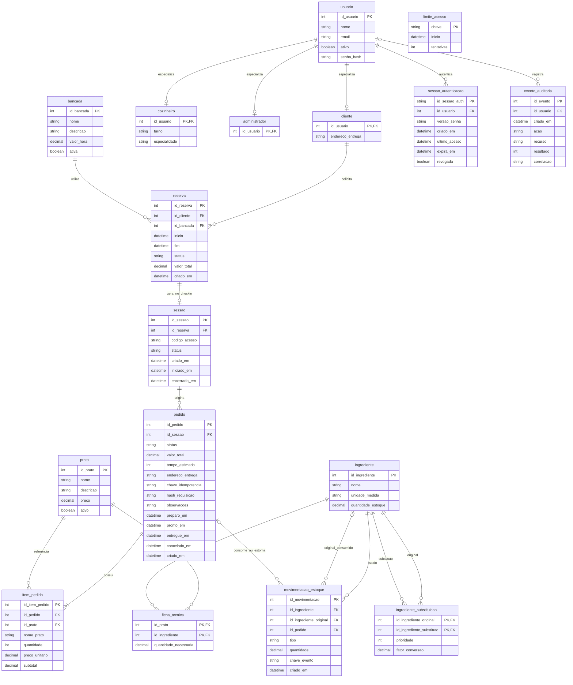

# Modelo relacional final

A reserva pode existir sem sessão; um prato pode existir sem vendas. As tabelas de segurança e movimentações integram o esquema final. Triggers não são utilizadas.

Os campos, tipos e restrições completos estão em Dicionario_final.pdf e 01_modelo_fisico.sql. A cardinalidade mínima de um item por pedido é assegurada pelo checkout transacional; a FK por si só não obriga a existência de filhos. A criação de um único perfil por conta é assegurada pelo fluxo da API, sem triggers de exclusividade entre especializações.